# Agentic AI Summit 2026

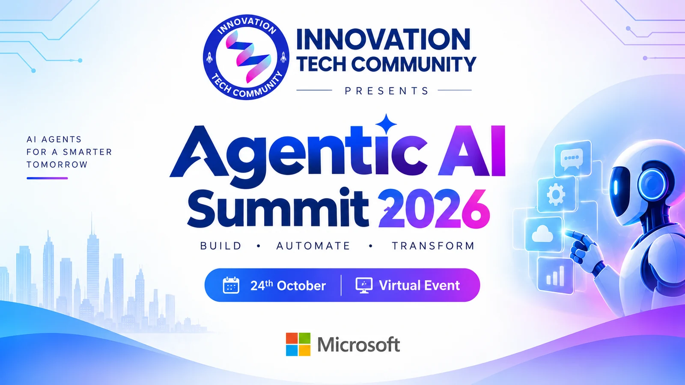

**A free, virtual summit on Agentic AI by [Innovation Tech Community](https://innovationtechcommunity.com).**
From AI copilots to autonomous agents: expert-led sessions, live demos and real-world use cases across the Microsoft AI ecosystem.

| | |
|---|---|
| 📅 **Date** | Saturday, 24 October 2026 |
| ⏰ **Time** | 9:00 AM – 4:10 PM IST (UTC+5:30) |
| 🎤 **Lineup** | 12 sessions · 13 speakers, all confirmed |
| 💻 **Where** | Virtual · live on YouTube, LinkedIn and Instagram |
| 🎟️ **Register (free)** | https://innovationtechcommunity.com/register/agentic-ai-summit-2026 |
| 🌐 **Event page** | https://innovationtechcommunity.com/events/agentic-ai-summit-2026 |
| ▶️ **YouTube live** | https://www.youtube.com/watch?v=bTTSVoPeRVc |
| 💼 **LinkedIn live** | _Add the LinkedIn event link here_ |
| 📸 **Instagram live** | _Add the Instagram handle here_ |
| 🎙️ **StreamYard studio** | One guest link for all speakers, valid all day. Shared privately by email. **Never commit studio or guest links here.** |
| 💬 **Speakers' WhatsApp group** | Shared privately with speakers by email |
| 🛂 **Passport stamp** | Registered attendees can claim the Agentic AI Summit 2026 stamp in their ITC Learning Passport |

## Schedule

All times IST. Each slot is **35 minutes: a 30-minute session + 5 minutes of Q&A** (the opening session is 45 minutes).

| Time (IST) | Speaker | Session | Format |
|---|---|---|---|
| 9:00 AM – 9:45 AM | Nanddeep Nachan & Smita Nachan | [Build a Secure Multi-Tool AI Agent with Microsoft Foundry, APIs, and MCP](https://innovationtechcommunity.com/events/agentic-ai-summit-2026#session-c3b72953-c3d8-4368-a9c3-be9c38e14c50) | Talk · 45 min |
| 9:45 AM – 10:20 AM | Sujin Nelladath | [AI-Powered IT Operations: Troubleshooting Smarter with MCP and Microsoft Learn](https://innovationtechcommunity.com/events/agentic-ai-summit-2026#session-5fd1ed34-d985-4657-9110-4490c437d584) | Talk · 35 min |
| 10:20 AM – 10:55 AM | Kritika Mehta | [The Zero-Handoff ERP: Architecting a Multi-Agent Workforce](https://innovationtechcommunity.com/events/agentic-ai-summit-2026#session-37704e28-7ee8-42c8-81a8-e5e642707f7e) | Live demo · 35 min |
| 10:55 AM – 11:30 AM | Divya Akula | [Build Your First AI Assistant: From Idea to Working Demo](https://innovationtechcommunity.com/events/agentic-ai-summit-2026#session-30889b60-0a11-42af-8295-ed6b86b4e015) | Talk · 35 min |
| 11:30 AM – 12:05 PM | Prathap Reddy | [From Copilots to Autonomous Agents: Building Agentic AI with Microsoft Foundry](https://innovationtechcommunity.com/events/agentic-ai-summit-2026#session-5ba183a6-38ac-407b-bcfe-d6521060a99b) | Talk · 35 min |
| 12:05 PM – 12:40 PM | Samik Roy | [More Than Prompt Safety and IAM : Design Policy-as-Code for Deterministic Multi-Agent AI Workflows](https://innovationtechcommunity.com/events/agentic-ai-summit-2026#session-ef3798d4-99bd-470c-abde-78659f0aadf9) | Talk · 35 min |
| 12:40 PM – 1:15 PM | Vinoth Rajendran | [From Idea to Agent: Building with Microsoft Agent Framework](https://innovationtechcommunity.com/events/agentic-ai-summit-2026#session-fdf65d11-7d1e-42f3-aed2-916aef2a1b59) | Talk · 35 min |
| 1:15 PM – 1:50 PM | Ashutosh Singh | [Building SnowPilot: Agentic AI in Action with Copilot Studio](https://innovationtechcommunity.com/events/agentic-ai-summit-2026#session-82913153-e6d5-40eb-a6e2-ae5c99d17588) | Live demo · 35 min |
| 1:50 PM – 2:25 PM | Shantha Kumar T | [Building with Confidence: Inside Microsoft’s Copilot Managed Runtime](https://innovationtechcommunity.com/events/agentic-ai-summit-2026#session-6dc18247-2c8c-43b1-bd4b-40fe60e63452) | Live demo · 35 min |
| 2:25 PM – 3:00 PM | Janarthanan Selvaraj | [Agents of Tomorrow: Building the Next Generation of AI with Microsoft Foundry](https://innovationtechcommunity.com/events/agentic-ai-summit-2026#session-375d8445-f3b4-4d7c-affe-8af2dc74bd27) | Talk · 35 min |
| 3:00 PM – 3:35 PM | Lalit Rawat | [From AI PoC Chaos to Production: Building a Secure Enterprise AI Landing Zone on Azure](https://innovationtechcommunity.com/events/agentic-ai-summit-2026#session-5c3a4248-9f9c-482a-9bdb-accf4ba53247) | Talk · 35 min |
| 3:35 PM – 4:10 PM | Frank Falvey | [Microsoft Agentic AI: Framework Overview & Live Agent Demos](https://innovationtechcommunity.com/events/agentic-ai-summit-2026#session-b69635a6-3f39-42d1-9049-a4312c66f913) | Talk · 35 min |

Also available as [`schedule.csv`](schedule.csv) and a calendar file, [`agentic-ai-summit-2026.ics`](agentic-ai-summit-2026.ics).

## Speakers

| Speaker | Role | Slot | Profile |
|---|---|---|---|
| Nanddeep Nachan | Microsoft MVP, MCT | 9:00 AM | [LinkedIn](https://www.linkedin.com/in/nanddeepnachan/) |
| Smita Nachan | Microsoft MVP · M365 Architect | 9:00 AM | [LinkedIn](https://www.linkedin.com/in/smitanachan) |
| Sujin Nelladath | Microsoft MVP | Architecting AI‑Driven Workplace Solutions | 9:45 AM | [LinkedIn](https://www.linkedin.com/in/sujin-nelladath-8911968a/) |
| Kritika Mehta | Solution Architect | Business Central & AI Architecture | 10:20 AM | [LinkedIn](https://www.linkedin.com/in/kritika-mehta-0350a614) |
| Divya Akula | AI Engineer & Community Speaker | Building Practical AI Applications · Senior Technical Consultant – AI & Microsoft Copilot Solutions | 10:55 AM | [LinkedIn](https://www.linkedin.com/in/ms-divya-akula/) |
| Prathap Reddy | Microsoft AI MVP · AI Engineer | 11:30 AM | [LinkedIn](https://www.linkedin.com/in/prathap-reddy-chenchappagari-microsoft-ai-mvp-86503a20a/) |
| Samik Roy | Microsoft MVP | 12:05 PM | [LinkedIn](https://www.linkedin.com/in/roysamik/) |
| Vinoth Rajendran | Microsoft AI MVP · Software Developer | 12:40 PM | [LinkedIn](https://www.linkedin.com/in/rvinothrajendran/) |
| Ashutosh Singh | Copilot Studio SME & Dynamics 365 CE at Tata Consultancy Services | 1:15 PM | [LinkedIn](https://www.linkedin.com/in/ashutosh-singh-6125b055) |
| Shantha Kumar T | Microsoft Copilot MVP · Chief Technology Officer | 1:50 PM | [LinkedIn](https://www.linkedin.com/in/ktskumar) |
| Janarthanan Selvaraj | Microsoft AI MVP and Senior Manager at Atos | 2:25 PM | [LinkedIn](https://www.linkedin.com/in/janarthananselvaraj/) |
| Lalit Rawat | CISO, Microsoft MVP, MCT, Public Speaker | 3:00 PM | [LinkedIn](https://www.linkedin.com/in/rawatlalit) |
| Frank Falvey | Microsoft MVP · Application Engineer | 3:35 PM | [LinkedIn](https://www.linkedin.com/in/frank-falvey) |

## Speaker banners

Ready to share on LinkedIn, Instagram and WhatsApp. The website generates them, so the live version is always at `https://innovationtechcommunity.com/banner/<session-id>`.

| Banner | Session |
|---|---|
| 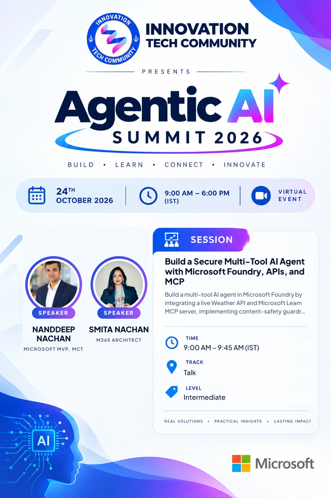 | **Nanddeep Nachan & Smita Nachan** 9:00 AM IST Build a Secure Multi-Tool AI Agent with Microsoft Foundry, APIs, and MCP |
| 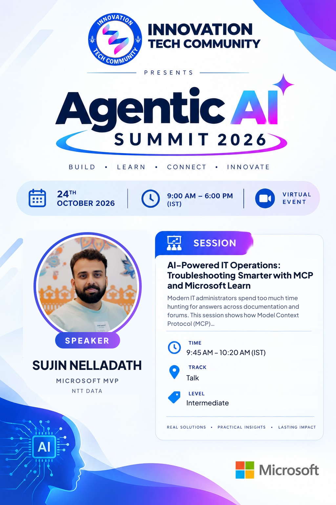 | **Sujin Nelladath** 9:45 AM IST AI-Powered IT Operations: Troubleshooting Smarter with MCP and Microsoft Learn |
| 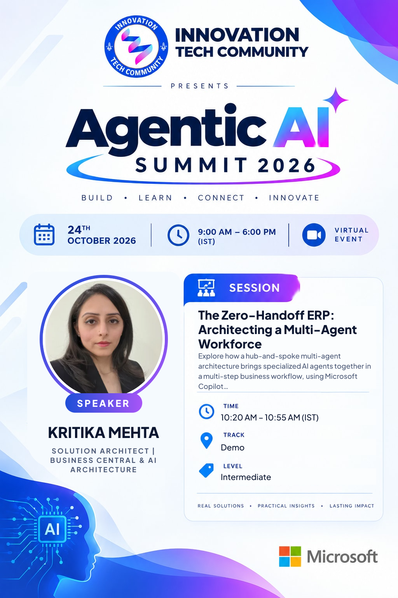 | **Kritika Mehta** 10:20 AM IST The Zero-Handoff ERP: Architecting a Multi-Agent Workforce |
| 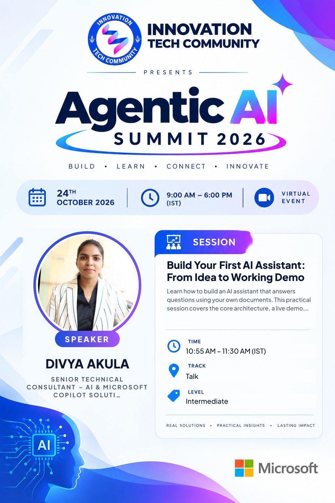 | **Divya Akula** 10:55 AM IST Build Your First AI Assistant: From Idea to Working Demo |
| 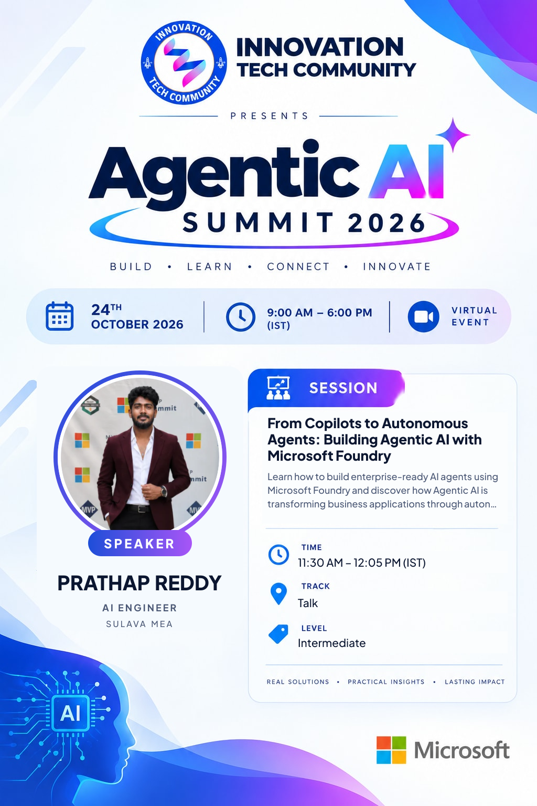 | **Prathap Reddy** 11:30 AM IST From Copilots to Autonomous Agents: Building Agentic AI with Microsoft Foundry |
| 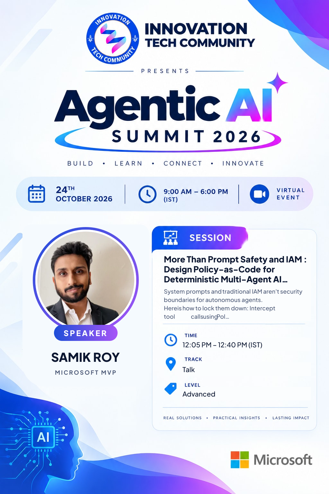 | **Samik Roy** 12:05 PM IST More Than Prompt Safety and IAM : Design Policy-as-Code for Deterministic Multi-Agent AI Workflows |
| 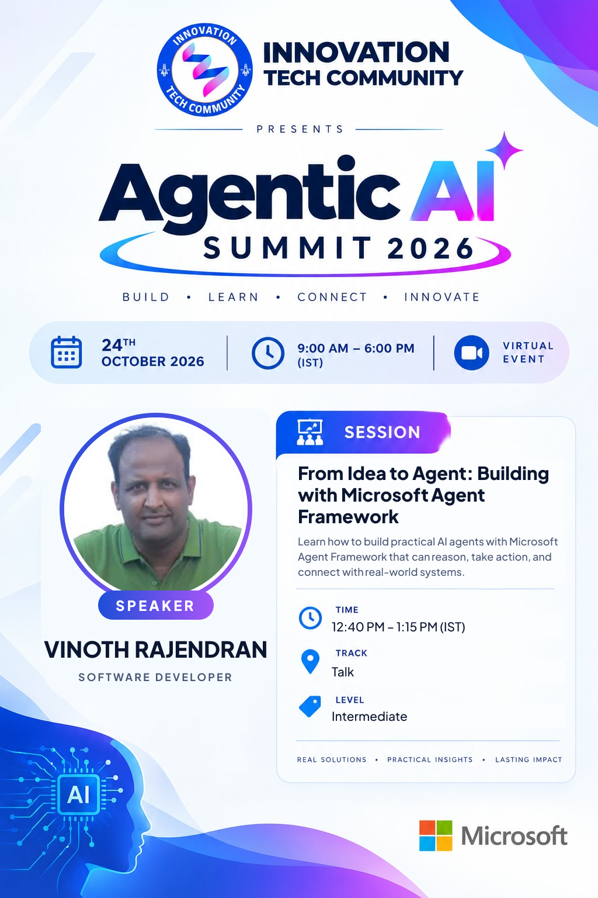 | **Vinoth Rajendran** 12:40 PM IST From Idea to Agent: Building with Microsoft Agent Framework |
| 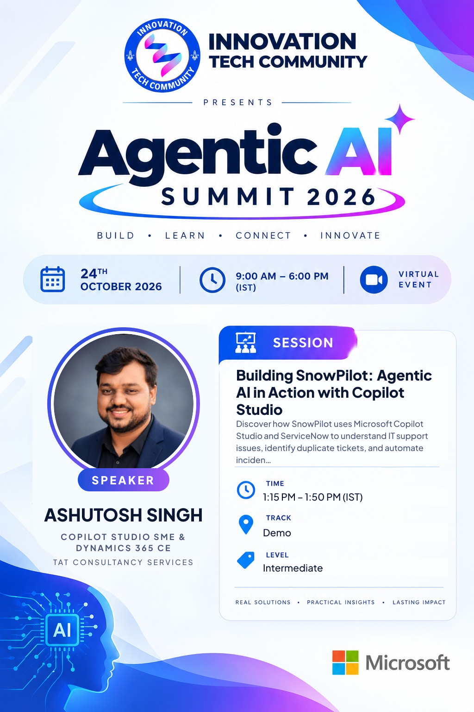 | **Ashutosh Singh** 1:15 PM IST Building SnowPilot: Agentic AI in Action with Copilot Studio |
| 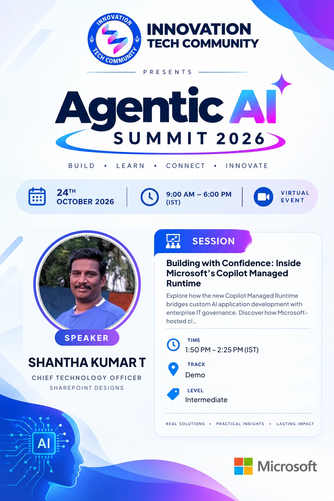 | **Shantha Kumar T** 1:50 PM IST Building with Confidence: Inside Microsoft’s Copilot Managed Runtime |
| 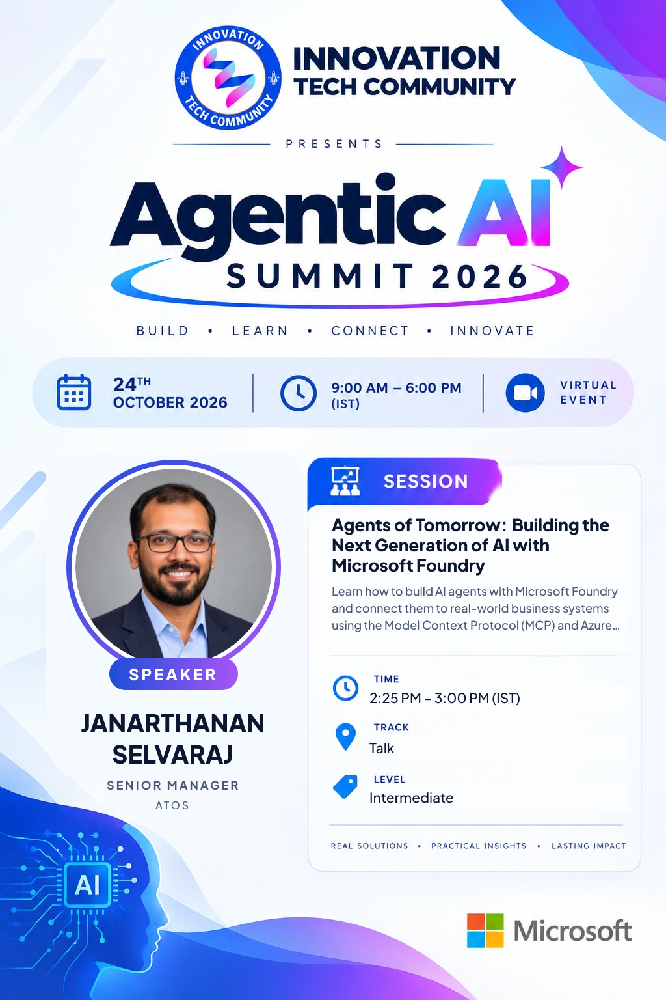 | **Janarthanan Selvaraj** 2:25 PM IST Agents of Tomorrow: Building the Next Generation of AI with Microsoft Foundry |
| 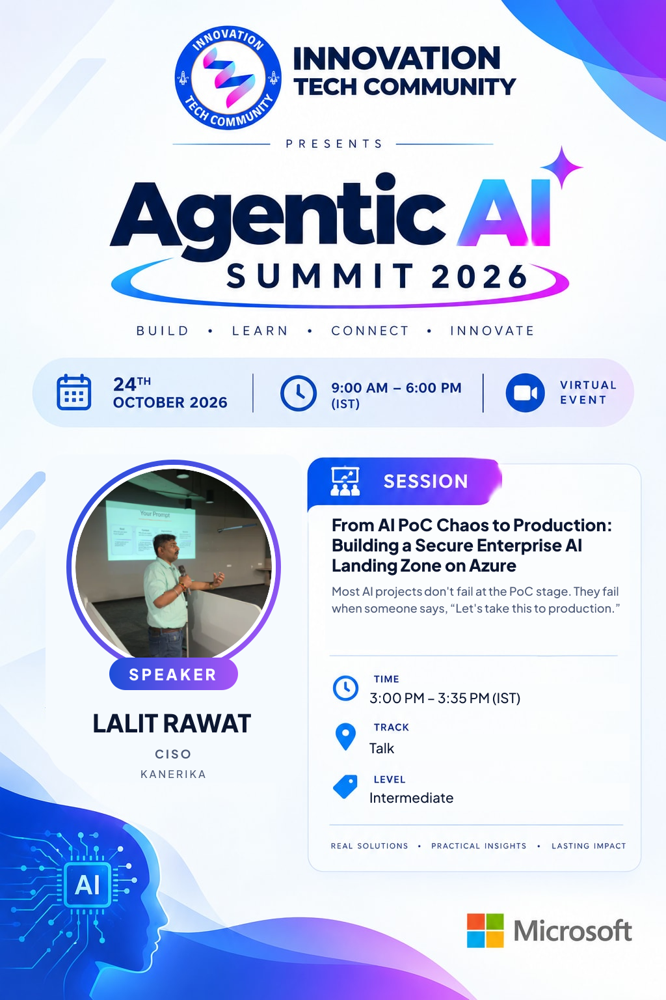 | **Lalit Rawat** 3:00 PM IST From AI PoC Chaos to Production: Building a Secure Enterprise AI Landing Zone on Azure |
| 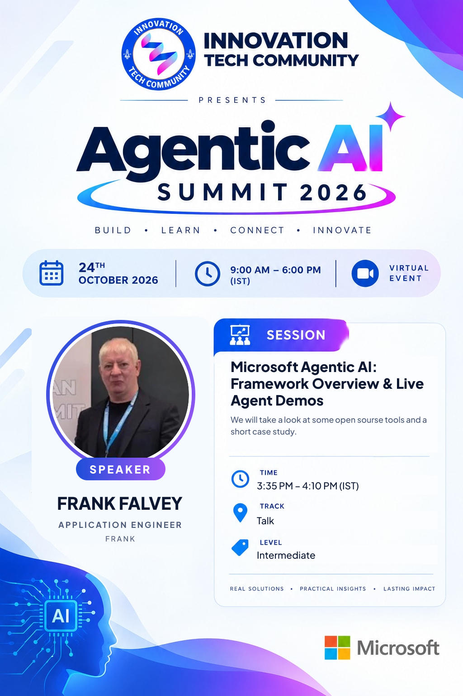 | **Frank Falvey** 3:35 PM IST Microsoft Agentic AI: Framework Overview & Live Agent Demos |

## Slides

| File | What it is |
|---|---|
| [`slides/agentic-ai-summit-2026-speaker-template.pptx`](slides/agentic-ai-summit-2026-speaker-template.pptx) | Branded slide template for speakers: title, about me, agenda, section divider, text and picture, code or demo, key takeaways and thank-you layouts |
| [`slides/agentic-ai-summit-2026-host-deck.pptx`](slides/agentic-ai-summit-2026-host-deck.pptx) | Host deck: welcome, housekeeping, about ITC, the day at a glance, agenda, one intro slide per session (with a ~2-minute intro script in the speaker notes) and the closing slide |

To rebuild the decks after a schedule change, see [`tools/README.md`](tools/README.md).

## Run of show

See [`run-of-show.md`](run-of-show.md) for the host checklist and the timing of each slot.

## Registrations

Registrations are managed on the website (Admin › Events & speakers › Agentic AI Summit 2026 › Registrations, with CSV export).
**Attendee details are personal data and are never stored in this repository.**

---

Innovation Tech Community · Learn together. Build together. Grow together. · #AgenticAISummit2026
